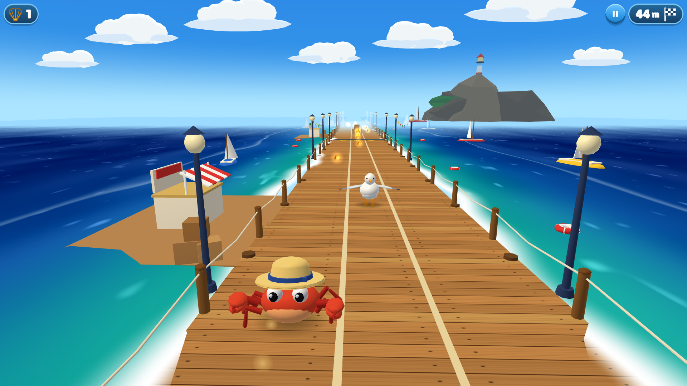

# Crab Dash

A three-lane beach runner for iPhone, Chromebook and PC browsers. Scuttle down the sand as Sandy the crab: dodge sandcastles, beach balls, logs, gulls and waves, grab golden shells, and dress your crab up in the Wardrobe.

**Update 2, "Sunny Season"**, adds toy-like shading with outlines and shadows, a fully rigged and animated crab, the Island Hop level mode, the Sunny Pass, the Daily Tide and the Wardrobe.

Everything you see and hear is generated in code: the models, textures, sound effects and music. The whole game downloads in about 300 KB.



## Play

Once GitHub Pages is enabled (see below), the game is published at:

**https://georrrgess-jpg.github.io/Crab-Rush/**

On an **iPhone**, open that link in Safari, tap Share, then **Add to Home Screen**. It then runs full-screen like an app. Sound needs the silent switch turned off.

### Controls

| | Touch | Keyboard | Mouse |
|---|---|---|---|
| Change lane | Swipe left or right, or tap the left/right half of the screen (the ◀ ▶ buttons do the same) | ← → or A D | Click the left/right half |
| Hop | Swipe up | ↑, W or Space | — |
| Drop fast (while airborne) | Swipe down | ↓ or S | — |
| Pause | Pause button | Esc or P | Pause button |

You can change lanes in mid-air. Hitting something head-on ends the run; clipping it from the side only bumps you back.

### What's in the game

- **Beach Run:** an endless run through four areas. Sunny Shore leads to Boardwalk Pier at 700 m, Tide Pool Cove at 1,600 m, and the endless Sunset Lagoon from 2,800 m. Night falls past 4,000 m.
- **Island Hop:** 24 handcrafted levels on four islands, each with three stars:
  - reach the flag;
  - grab all three golden sand dollars;
  - meet the level's own challenge.

  Stars open the next island. Four levels are chases where the Great Wave is right behind you.
- **Daily Tide:** a 30-day score calendar and a week-ahead tide almanac with your best per twist. One course a day that is the same for everyone, with a rotating twist (Low Tide, Gull Day, Big Waves, Mirror Beach, Magnet Madness, Night Run, Ball Storm). Keep a daily streak going for bonus XP, a Flower Crown at 7 days and the Moonscuttle dance at 30. Streak savers cover a missed day.
- **Sunny Pass:** a free 40-tier reward track. Every mode earns XP. Rewards include hats, trails, crab colours, dances, shells and Golden Shells (2× shells for one run). After tier 40, every 1,000 XP opens a bonus pearl chest.
- **Wardrobe:** mix and match any body, 19 hats, 6 trails and 6 victory dances, and upgrade your power-ups. Save three outfits, let Surprise Me pick one, and recolour hats with pearl dyes.
- **Crab Cove:** your own little island. Spend shells and pearls on 24 decorations across 12 plots; Comfort raises the shells your Cove's Tide Gifts pay while you are away (up to 8 hours). Six crab friends move in as Comfort grows, each with a three-step quest chain.
- **Trophies:** 36 achievements in 12 families that pay pearls and unlock titles for your profile card.
- **Island Hop+:** star chests on every island, Tide Rush crowns (a faster replay with no power-ups), four bonus levels, coconut-dropping gulls and shell rings.
- **Obstacles:**
  - Tall ones (sandcastles, crates, boulders, gulls): dodge them.
  - Low ones (logs, deck chairs, urchins, beach balls): hop or dodge.
  - Waves: hop.
  - Island Hop adds bounce pads, tide pools and hourglass shells.
- **Power-ups:**
  - Shell Magnet pulls shells toward you.
  - Bubble Shield absorbs one crash.
  - Wave Rider lets you surf over everything.

  Each has 4 upgrade levels.
- **Accessibility:** Reduce Motion, left-handed layout, high-contrast outlines, swipe sensitivity and haptics settings.

## Turning on GitHub Pages (one time)

1. In the repository on GitHub, open **Settings → Pages**.
2. Under **Build and deployment → Source**, choose **GitHub Actions**.
3. Run the workflow: **Actions → Build and deploy to GitHub Pages → Run workflow**, picking the branch with the game. It also runs automatically on every push to `main` or `claude/great-cray-2m0jl9`.

The game is then at `https://<user>.github.io/<repo>/`. On a phone, open that address and add it to the home screen (Safari: **Share → Add to Home Screen**; Chrome: **⋮ → Add to Home screen / Install app**). It opens full screen like an app, and after the first visit it also plays offline (`public/sw.js`).

GitHub Pages needs a public repository, or a paid GitHub plan for private ones. If the run is refused for the branch, open **Settings → Environments → github-pages** and allow that branch, or merge the work into the default branch first.

## Development

Requires Node 20.19+ or 22.12+.

```bash
npm install
npm run dev              # dev server (also reachable from a phone on the same network)
npm test                 # unit tests: fairness solver, patterns, autopilot fairness (incl. every Daily Tide modifier), levels, goals, economy, save + v1→v2 migration, XP/pass/daily, audio, quality
npm run build            # production build into dist/
npm run shots -- <label> # real screenshots via Playwright into docs/screenshots/
node scripts/smoke.mjs   # end-to-end smoke test in Chromium (controls, tutorial, wardrobe, pass, daily, island hop, settings, pause, results, music)
node scripts/perf.mjs    # draw-call / triangle budgets per quality tier, zone, Home and a full Cove
node scripts/ui-audit.mjs  # every screen at five viewports: overlaps, text overflow, small targets, scroll
BALANCE=1 npx vitest run tests/balance.test.ts   # run length, shell income and Island Hop attempts for simulated novice, average and skilled players
```

### Debug URL flags

| Flag | Effect |
|---|---|
| `?debug` | Overlay with fps, frame time, draw calls, triangles, DPR, quality tier, speed, tier, zone and current pattern |
| `?seed=N` | Fixed random seed |
| `?start=1500` | Start a run at that distance (or zone) |
| `?god` | No crashes |
| `?autopilot` | The game plays itself |
| `?quality=low\|medium\|high` | Force a graphics tier |
| `?reset` | Wipe saved progress on load |

### How it's built

- **Three.js + TypeScript + Vite**, with no other runtime dependencies besides two self-hosted fonts.
- **`src/sim/`** is the pure simulation and never imports three.js. It covers player physics, collisions, the spawner, Island Hop levels and objectives, and the goals and economy logic.
  - The **pattern library** has 33 handcrafted obstacle patterns.
  - A **fairness solver** checks every pattern against human reaction-time rules, and again at runtime before it is placed. Autopilot tests drive the real simulation for hundreds of kilometres, across every level and Daily Tide modifier, without an unavoidable crash.
- **`src/meta/`** is pure progression logic: XP and the Sunny Pass, the Wardrobe catalogue, Daily Tide dates and streaks, island gates and chests, and the Crab Cove (decor, gifts, friends, achievements).
- **`src/render/`** draws the game:
  - A "toy" shader family with outlines, shadow maps on High, and wind.
  - A 37-bone rigged crab with a sculpted shell, springs, squash and stretch, emotes and dances.
  - A timeline-driven boot cinematic and a 3D Crab Cove island scene.
  - Scenery tiles merged into a few draw calls, plus instanced shells, shadows and particles; models switch to low detail past 50 m.
  - Sky and ocean shaders, and a day-to-night cycle.
  - Auto quality that scales resolution, and between runs the graphics tier.
- **`src/ui/`** is the DOM/CSS interface: a screen router, design tokens and one module per screen. **`src/core/`** has the fixed 120 Hz loop, input, save (v3, with v1 and v2 migration), synthesised audio and quality code.
- Every tunable lives in **`src/config.ts`**. The designs are in **[`PLAN.md`](PLAN.md)** (v1) and **[`UPDATE2_PLAN.md`](UPDATE2_PLAN.md)** (Update 2) and **[`UPDATE3_PLAN.md`](UPDATE3_PLAN.md)** (Update 3, "Shell Shock").

### Performance budgets (measured at the busiest moments)

| Tier | Draw calls | Triangles | Budget |
|---|---|---|---|
| High | ≤ 71 | ≤ 118k | 100 / 150k |
| Medium | ≤ 63 | ≤ 96k | 80 / 100k |
| Low | ≤ 50 | ≤ 50k | 60 / 60k |
